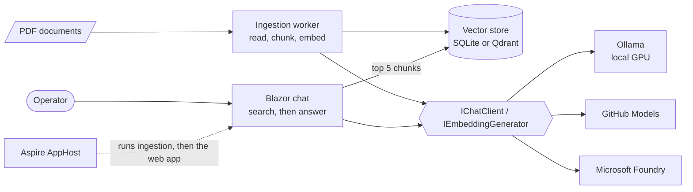

# ShopFloor Assistant

> **Ask your work instructions.** An AI assistant for machine operators and maintenance technicians that answers questions from SOPs, work instructions and machine manuals, and always shows the source page.

[](https://github.com/TomasWarchol/shopfloor-assistant/actions/workflows/ci.yml)


[](LICENSE)

> 🚧 **Work in progress.** Milestones 1 (skeleton, provider-agnostic AI layer), 2 (PDF ingestion) and 3 (chat with citations, follow-up questions) are done. Next: answer evaluations in CI with a hosted model.

## Example

A question in Polish, answered from the English press manual by the local 4B model:

> **Co zrobić przy alarmie E214?** *(What to do when alarm E214 appears?)*
>
> Przy alarmie E214 należy:
> 1. Zatrzymać produkcję.
> 2. Sprawdzić przepływ wody chłodzącej (minimalnie 40 L/min) i poziom oleju.
> 3. Uruchomić ponownie tylko wtedy, gdy temperatura oleju będzie poniżej 55 °C **[1]**.
>
> **[1]** HP-250 Hydraulic Press – Operation and Maintenance Manual · page 4 · 9 Alarms and troubleshooting *(the link opens the PDF on page 4)*

A question the documents cannot answer gets "Could not find it in the documents. Please ask the shift supervisor." and a warning that no document is cited.

## Why

On a production line the answer is usually somewhere in a long PDF: a work instruction, a changeover procedure or a 300-page machine manual. Finding it takes time, so people ask a colleague or guess.

ShopFloor Assistant answers in seconds **and cites the exact document and page**, so the operator can check the answer instead of trusting it blindly.

All documents in this repository are synthetic, made for the fictional Contoso Metal Stamping plant. No real company data is used.

## Features

- [x] Provider-agnostic AI: local **Ollama**, **GitHub Models** or **Microsoft Foundry**, switched in configuration ([ADR 2](docs/adr/0002-provider-agnostic-ai-clients.md))
- [x] OpenTelemetry for model calls and token usage in the Aspire dashboard
- [x] Fail-fast configuration validation with actionable messages
- [x] PDF ingestion that keeps tables, numbered steps and page numbers intact ([ADR 4](docs/adr/0004-page-aware-chunking.md))
- [x] Cross-lingual retrieval: ask in Polish, find the answer in English manuals and vice versa ([ADR 3](docs/adr/0003-local-multilingual-embeddings.md))
- [x] Vector store without Docker (SQLite), or Qdrant when Docker is available ([ADR 5](docs/adr/0005-vector-store.md))
- [x] Retrieval-quality evaluation with real embeddings: right chunk in the top 3 for every test question (hit@3 100 %, MRR 0.92)
- [x] Chat with streaming answers in the language of the question, citations linked to the PDF page ([ADR 6](docs/adr/0006-grounded-answers.md))
- [x] Says "not found" instead of guessing, and warns when an answer cites no document
- [x] Documents treated as untrusted: sources in delimited elements, answers rendered without raw HTML, no path traversal through citation links
- [x] Answer evaluation with the local model: the right fact and the right document for every test question
- [x] Follow-up questions ("How often do I have to do it?") rewritten with the conversation context before searching ([ADR 7](docs/adr/0007-follow-up-question-rewriting.md))
- [ ] Answer-quality evaluations in CI with a hosted model

## Architecture



| Project | Responsibility |
|---|---|
| `src/ShopFloorAssistant.AppHost` | Aspire orchestration: runs ingestion, then the web app; hosts the dashboard |
| `src/ShopFloorAssistant.Ingestion` | Worker that indexes the PDFs and exits |
| `src/ShopFloorAssistant.Web` | Blazor (interactive server) chat; serves the cited PDFs |
| `src/ShopFloorAssistant.Core` | AI clients, PDF reading, chunking, indexing, search, grounded answers and citations |
| `src/ShopFloorAssistant.ServiceDefaults` | Shared OpenTelemetry, health checks and resilience defaults |
| `tools/ShopFloorAssistant.SampleDocuments` | Generates the sample PDFs from Markdown sources |
| `tests/ShopFloorAssistant.Core.Tests` | xUnit v3 tests on Microsoft Testing Platform, including the evaluations |
| `tests/ShopFloorAssistant.Web.Tests` | Tests for safe rendering of answers |

### How a PDF becomes searchable

1. **Read**: PdfPig layout analysis. Running headers and footers are dropped, table cells are joined into rows (`E214 | Oil temperature high | ...`), and list numbers stay with their step.
2. **Chunk**: at most 500 characters, never across a page, a new chunk at every numbered heading. Each chunk knows its section path, for example `9 Alarms and troubleshooting`.
3. **Embed**: `title + section + text` with bge-m3, in batches.
4. **Store**: one collection per embedding model. Re-ingesting a document replaces its chunks.

## Getting started

**Prerequisites:** [.NET 10 SDK](https://dotnet.microsoft.com/download), [Aspire CLI](https://aspire.dev) (`dotnet tool install -g Aspire.Cli`) and [Ollama](https://ollama.com). Docker is optional.

```bash
ollama pull qwen3:4b-instruct
ollama pull bge-m3
aspire run
```

Aspire runs the ingestion worker first (about a minute on a laptop GPU), then starts the web app. Open the dashboard link printed in the console, then the `web` endpoint to chat. The dashboard also shows a trace of every embedding and chat call, with token counts.

### Choosing the vector store

| Store | How to run | Notes |
|---|---|---|
| SQLite (default) | `aspire run` | A single file in `.data/`, nothing to install |
| Qdrant | `aspire run -- VectorStore:Provider=Qdrant` | Needs Docker; runs as a persistent container |

### Choosing a model provider

The default runs fully locally. To use a stronger hosted model for chat while keeping embeddings local, switch the chat provider in `src/ShopFloorAssistant.Web/appsettings.json` and store the key in user-secrets:

| Provider | `AI:Chat:Provider` | `AI:Chat:Model` example | Secret |
|---|---|---|---|
| Ollama (default) | `Ollama` | `qwen3:4b-instruct` | none |
| GitHub Models | `GitHubModels` | `openai/gpt-4.1-mini` | `AI:GitHubModels:ApiKey`: a GitHub token with `models:read` |
| Microsoft Foundry | `Foundry` | your deployment name | `AI:Foundry:Endpoint` and `AI:Foundry:ApiKey` |

```bash
dotnet user-secrets set "AI:GitHubModels:ApiKey" "<token>" --project src/ShopFloorAssistant.Web
```

## Sample documents

Four synthetic documents in [`samples/documents`](samples/documents): a hydraulic press manual, a die change SOP, a lockout/tagout procedure and a quality work instruction in Polish. They have running headers, footers, tables and numbered procedures, like real plant documents. To regenerate them after editing the Markdown in `samples/source`:

```bash
dotnet run --project tools/ShopFloorAssistant.SampleDocuments
```

## Tests

```bash
dotnet test                   # unit and integration tests, no network or containers
dotnet test --explicit only   # tests with real models: smoke test, retrieval and answer evaluations (needs Ollama)
```

- **Retrieval evaluation**: 8 Polish and English questions. It checks that the chunk with the answer is retrieved and fails if hit@3 drops below 85 % or MRR below 0.80.
- **Answer evaluation**: the full pipeline with the chat model. Each answer must contain the fact from the document and cite the right document, and a question outside the documents must cite nothing.

## Design decisions

Architecture decisions are recorded in [`docs/adr`](docs/adr).

## License

[MIT](LICENSE)
