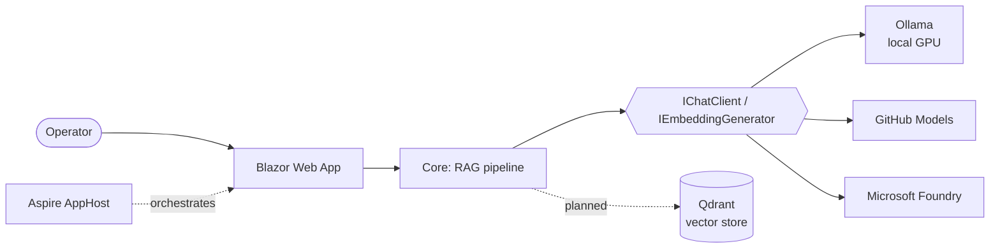

# ShopFloor Assistant

> **Ask your work instructions.** An AI assistant for machine operators and maintenance technicians that answers questions from SOPs, work instructions and machine manuals, and always shows the source page.

[](https://github.com/TomasWarchol/shopfloor-assistant/actions/workflows/ci.yml)


[](LICENSE)

> 🚧 **Work in progress.** Milestone 1 (solution skeleton and a provider-agnostic AI layer) is done. Document ingestion is next.

## Why

On a production line the answer is usually somewhere in a long PDF: a work instruction, a changeover procedure or a 300-page machine manual. Finding it takes time, so people ask a colleague or guess.

ShopFloor Assistant answers in seconds **and cites the exact document and page**, so the operator can check the answer instead of trusting it blindly.

All documents in this repository are synthetic. No real company data is used.

## Features

- [x] Provider-agnostic AI: local **Ollama**, **GitHub Models** or **Microsoft Foundry**, switched in configuration ([ADR 2](docs/adr/0002-provider-agnostic-ai-clients.md))
- [x] OpenTelemetry for model calls and token usage in the Aspire dashboard
- [x] Fail-fast configuration validation with actionable messages
- [ ] PDF ingestion with page-aware chunking
- [ ] Cross-lingual retrieval: ask in Polish, find the answer in English manuals ([ADR 3](docs/adr/0003-local-multilingual-embeddings.md))
- [ ] Chat with streaming answers and citations
- [ ] Guardrails against prompt injection hidden in documents
- [ ] Answer-quality evaluations (groundedness, relevance) in CI

## Architecture



| Project | Responsibility |
|---|---|
| `ShopFloorAssistant.AppHost` | Aspire orchestration: runs the app and its dependencies, hosts the dashboard |
| `ShopFloorAssistant.Web` | Blazor (interactive server) user interface |
| `ShopFloorAssistant.Core` | AI client registration, and later the ingestion and retrieval pipeline |
| `ShopFloorAssistant.ServiceDefaults` | Shared OpenTelemetry, health checks and resilience defaults |
| `tests/ShopFloorAssistant.Core.Tests` | xUnit v3 tests on Microsoft Testing Platform |

## Getting started

**Prerequisites:** [.NET 10 SDK](https://dotnet.microsoft.com/download), [Aspire CLI](https://aspire.dev) (`dotnet tool install -g Aspire.Cli`) and [Ollama](https://ollama.com).

```bash
ollama pull qwen3:4b
ollama pull bge-m3
aspire run
```

Open the dashboard link printed in the console, then open the `web` endpoint.

### Choosing a model provider

The default runs fully locally. To use a stronger hosted model for chat while keeping embeddings local, switch the chat provider in `src/ShopFloorAssistant.Web/appsettings.json` and store the key in user-secrets:

| Provider | `AI:Chat:Provider` | `AI:Chat:Model` example | Secret |
|---|---|---|---|
| Ollama (default) | `Ollama` | `qwen3:4b` | none |
| GitHub Models | `GitHubModels` | `openai/gpt-4.1-mini` | `AI:GitHubModels:ApiKey`: a GitHub token with `models:read` |
| Microsoft Foundry | `Foundry` | your deployment name | `AI:Foundry:Endpoint` and `AI:Foundry:ApiKey` |

```bash
dotnet user-secrets set "AI:GitHubModels:ApiKey" "<token>" --project src/ShopFloorAssistant.Web
```

## Tests

```bash
dotnet test                   # unit tests, no network
dotnet test --explicit only   # tests that call the local Ollama model
```

## Design decisions

Architecture decisions are recorded in [`docs/adr`](docs/adr).

## License

[MIT](LICENSE)
